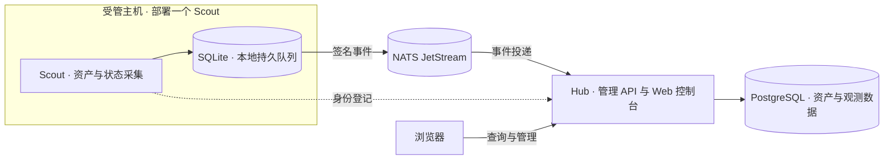

# Sentinel

**集中掌握每一台 Linux 主机的资产与运行状态。**

Sentinel 是面向 Linux 服务器和裸机的主机资产与安全可观测平台。在主机上部署 Scout，即可通过 Hub 的 Web 控制台查看系统信息、资源使用、网络端口、进程和已安装软件包，按分组与标签管理主机。

## 核心能力

| 能力 | 用途 |
| --- | --- |
| 主机资产 | 汇总系统、架构与主机身份信息，支持管理分组和多个标签 |
| 运行状态 | 查看 CPU、内存使用情况，以及网卡流量与收发速率 |
| 网络端口 | 查看 TCP/UDP 监听或绑定端点，支持隐藏回环地址 |
| 进程与软件包 | 查看进程数量与明细，检索由 dpkg 管理的已安装软件包及版本 |
| 可靠上报 | 使用签名事件与本地持久队列，在连接恢复后补传缓存数据 |
| 统一控制台 | 在浏览器中查询主机资产、采集详情和数据覆盖情况 |

Scout 从宿主机视角进行只读采集，支持原生 systemd 服务和 Docker 容器两种运行方式，并自动识别运行环境。

## 架构



- **Hub** 部署在管理服务器上，接收和存储采集结果，提供管理界面与 API。
- **Scout** 部署在每台受管主机上，采集宿主信息并通过 NATS 上报；断线时使用本地队列缓存。
- **PostgreSQL 与 NATS JetStream** 是 Hub 的外部依赖，可与 Hub 同机部署，也可独立运行。

## 选择部署方式

支持 **Ubuntu 22.04 / 24.04**，架构为 **amd64 / arm64**。

| 方式 | 适用场景 | 入口 |
| --- | --- | --- |
| Docker Compose | 在本机体验完整系统，包含 Hub、Scout、PostgreSQL 和 NATS | [本机体验](docs/deployment.md#3-开发环境部署本机-loopback) |
| systemd | 将 Hub 或 Scout 安装为服务器上的系统服务 | [原生安装脚本](scripts/install-systemd.sh) |
| Docker Scout | 在已有 Docker 环境的主机上安装 Scout | [容器安装脚本](scripts/install-scout.sh) |
| 本地构建包 | 从源码构建并试用原生版本 | [构建与安装](docs/deployment.md#55-本地自建包试用未签名仅本机开发) |

## 一键部署

安装脚本负责下载、验证签名、初始化和启动服务。原生安装使用 systemd；容器安装使用 Docker，并配置 Scout 所需的特权模式及宿主目录只读挂载。

**版本选择：** 下方 `v0.1.0` 是格式示例，请替换为 [Releases](https://github.com/J1a-wei/Sentinel/releases) 中实际存在的签名版本。目前尚无签名发布版本，可先使用上面的本机体验或本地构建包方式。

### 安装前准备

- 安装主机需要 `curl`、Bash、Python 3 和 Cosign 3.x；原生方式需要 systemd，容器方式还需要 Docker Engine 与 buildx 插件。
- 为 Hub 准备 PostgreSQL 和启用 JetStream 的 NATS。安装器不安装这两个依赖。
- 凭证保存在权限为 `0600` 的文件中。`database-url` 保存 PostgreSQL 连接串，`admin.token` 保存至少 32 字符的随机 Hub 管理令牌，`nats.token` 保存 NATS 传输令牌。Scout 的 `enroll.token` 使用 Hub 管理员提供的登记凭证。

当前版本适用于本机或受控内网环境。下方跨主机示例使用 HTTPS 和 NATS TLS，要求事先配置 Hub 反向代理与 NATS 的 TLS、鉴权；安装器不配置这些网络边界。详细要求见[部署指南](docs/deployment.md#1-定位与安全边界务必先读)。

### Hub · systemd

在管理服务器上下载并查看安装脚本，然后执行安装：

```sh
VERSION=v0.1.0
curl -fsSL \
  "https://raw.githubusercontent.com/J1a-wei/Sentinel/${VERSION}/scripts/install-systemd.sh" \
  -o install-systemd.sh
less install-systemd.sh

sudo bash install-systemd.sh --component hub --version "${VERSION}" \
  --database-url-file database-url \
  --admin-token-file admin.token \
  --nats-url tls://nats.example.com:4222 \
  --nats-token-file nats.token
```

Hub 默认监听 `127.0.0.1:8080`。在本机打开 <http://127.0.0.1:8080>，使用 `admin.token` 中的令牌登录；远程访问使用已配置的 HTTPS 入口。

### Scout · systemd

在每台受管主机上执行，替换 Hub 和 NATS 地址并准备对应凭证文件：

```sh
VERSION=v0.1.0
curl -fsSL \
  "https://raw.githubusercontent.com/J1a-wei/Sentinel/${VERSION}/scripts/install-systemd.sh" \
  -o install-systemd.sh
less install-systemd.sh

sudo bash install-systemd.sh --component scout --version "${VERSION}" \
  --hub-url https://hub.example.com \
  --nats-url tls://nats.example.com:4222 \
  --nats-token-file nats.token \
  --enroll-token-file enroll.token
```

安装器完成运行环境自检、身份初始化与 Hub 登记，并设置服务开机启动。Scout 常驻服务不保留用于登记的管理员令牌。

### Scout · Docker

在受管主机上使用容器运行 Scout：

```sh
VERSION=v0.1.0
curl -fsSL \
  "https://raw.githubusercontent.com/J1a-wei/Sentinel/${VERSION}/scripts/install-scout.sh" \
  -o install-scout.sh
less install-scout.sh

sudo bash install-scout.sh --version "${VERSION}" \
  --hub-url https://hub.example.com \
  --nats-url tls://nats.example.com:4222 \
  --nats-token-file nats.token \
  --enroll-token-file enroll.token
```

安装完成后，主机及其采集结果会出现在 Hub 控制台。每个安装命令都可追加 `--plan` 预览配置，或使用 `--verify-only` 仅验证发布产物。脚本面向全新安装，不覆盖已有安装或执行升级。

## 签名验证

正式发布的容器镜像与原生安装包通过 **Cosign** 验证来源。安装器固定仓库、发布工作流、版本标签与 OIDC 签发者，验证成功后才运行镜像或解包安装。

手动验证命令见[镜像签名验证](docs/deployment.md#43-脚本的安全行为)与[原生包签名验证](docs/deployment.md#52-安装包与签名验证)。本地构建包和 CI 测试产物属于未签名产物。

## 日常使用

systemd 服务：

```sh
systemctl status sentinel-hub
systemctl status sentinel-scout
sudo journalctl -u sentinel-scout -f
```

Docker Scout：

```sh
docker logs -f sentinel-scout
docker exec sentinel-scout scout status
```

## 文档

- [部署指南](docs/deployment.md)：环境准备、安装、配置和常见问题。
- [配置示例](configs)：Hub 与 Scout 的环境变量示例。
- [架构说明](docs/architecture.md)：组件职责与数据流。
- [开发指南](AGENTS.md)：源码组织、开发约定与贡献检查。
