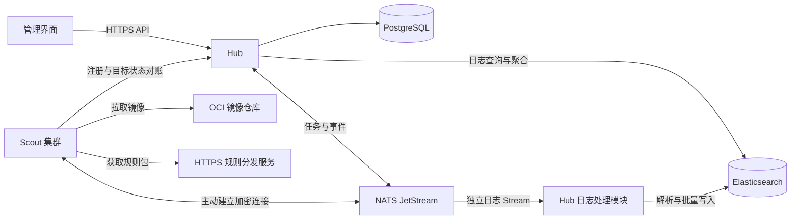

# Sentinel 技术栈与架构规划

本文记录 Hub、Scout 的技术选型、原生与容器部署、数据通信、日志存储和自动升级设计。Hub 与 Scout 统一使用 Rust；当前已接通一期 A 的资产与采集开发链路，具体接口与交付边界见 [实现接口约定](implementation-contract.md)。本文包含后续设计，不代表所有能力已实现。功能清单和验收口径见 [需求与分期](requirements.md)，表结构、事务边界与保留策略见 [数据库设计](database.md)。

## 已确认的范围与决策

| 项目 | 决策 |
| --- | --- |
| 开发语言 | Hub 与 Scout 统一 Rust |
| 项目结构 | 单仓库，Cargo workspace 管理 Hub、Scout 与共享协议 |
| Hub | 接收 Scout 上报，提供主机管理、检测结果展示、策略管理和升级管理 |
| 服务对象 | 单一组织内部使用，通过主机分组和用户角色划分管理权限；首期不建设多客户 SaaS 租户体系 |
| Hub Web 框架 | Axum + Tokio |
| 数据库 | PostgreSQL |
| 资产管理模型 | 每台主机一个管理分组，多个标签用于灵活筛选 |
| 指标历史 | 分钟级保留 7 天，小时级保留 90 天；具体采样频率待压测 |
| 程序运行日志 | tracing 结构化 JSON 输出 |
| 消息系统 | NATS JetStream，承接任务、重要事件和后续关键系统日志的可靠传输与缓冲 |
| 系统日志存储 | Elasticsearch，用于跨主机安全调查，按来源 IP、账号和事件类型检索及聚合；不增加 Kafka |
| Scout | 部署在 VM、裸金属主机，首期覆盖资产、运行状态、软件包漏洞及 SSH/认证配置基线 |
| AI 相关需求 | 需要支持异常后的诊断；建议先提供结构化只读诊断任务，具体模型接入形态与阶段待定 |
| 后续检测范围 | 恶意文件扫描放到第二期；进程及网络行为检测放到后续阶段 |
| 首期处置模式 | 只告警、只读扫描，不自动删除文件、隔离主机、终止进程或修改系统配置 |
| 首期操作系统 | Linux，优先支持 Ubuntu 22.04、24.04 |
| 部署规模 | 1,000 台以上 |
| Hub 部署 | 支持 systemd 原生服务与容器两种形态；原生形态由 systemd 监督并读取私有凭证文件 |
| Scout 部署 | 支持 systemd 原生服务与特权容器两种形态；原生形态以 root 读取宿主，容器按检测能力挂载所需宿主机目录 |
| 容器运行时 | 容器路线使用 Docker Engine；Docker 不再是所有部署形态的统一前置条件 |
| Scout 升级 | Hub 触发；容器形态升级逻辑内置于 Scout，不设置独立 updater。原生形态自动升级尚未实现 |
| Scout 实例数量 | 平时一个常驻 Scout 服务，原生形态由 systemd 监督单一进程；容器内允许必要的检测引擎子进程，容器升级期间允许新旧实例短暂并存并完成交接 |
| 资源与检测能力 | 按主机资源提供不同检测档位，Hub 明确展示每台主机具备和缺失的能力 |
| 检测证据上报 | 默认上报结果、规则编号和必要的脱敏证据；文件扫描阶段可包含摘要；关键系统日志按采集策略启用，额外文件内容、完整命令行及原始日志需授权 |

协作规范以根目录 [AGENTS.md](../AGENTS.md) 为准。本文件记录架构决策，不新增协作规则。

## 首期产品边界

首期聚焦机器资产与指纹、宿主运行状态、软件包漏洞、端口和进程概况、SSH 与认证配置基线。异常诊断建议以有类型、有范围的只读任务落地，为后续 AI 分析提供结构化证据。原“首期恶意文件实时检测”的安排已由新的分期替代，恶意文件扫描属于第二期。

软件包漏洞评估与配置基线分别建模。Scout 采集宿主已安装软件包，建议由 Hub 统一同步 Ubuntu 漏洞情报并匹配；SSH 基线评估配置和密码策略，不把密码策略合规解释为已验证现有密码强度。资产身份、端口和指标统计、未知结果及数据过期等口径详见 [需求与分期](requirements.md)。

关键系统日志的查询方向和 Elasticsearch 已确定；具体日志来源、字段、保留期限和开始接入的阶段待细化。正式 UI 使用 Vue 3、TypeScript 与 Vite，视觉参考已有原型；“统一 Rust”针对 Hub 与 Scout。

检测默认只读，结果通过 Hub 展示和告警，不自动删除文件、隔离主机、终止进程或修改系统配置。只读约束针对受检业务文件及系统配置，Scout 自身状态持久化、规则更新和已确认的容器升级仍按各自流程执行。自动处置作为后续独立能力，在验证误报率和业务影响后按策略开启。

平台服务于单一组织，使用主机分组和用户角色划分查看结果、管理策略和发布升级等权限。具体登录方式及角色权限矩阵仍待确定。

## Rust 工程组织

工程采用 Cargo workspace，在 `crates/hub` 和 `crates/scout` 中分别管理服务端与 Agent，`crates/protocol` 定义共用事件协议。入口负责配置、初始化、启动和退出协调，业务逻辑留在各自模块中，Scout 不引入 Hub 的数据库和日志检索依赖。

workspace 统一管理共享依赖并保留 `Cargo.lock`；工具链固定 Rust 1.97.1、edition 2024，最低版本声明为 1.97，通过 Cargo 配置与 `rust-toolchain.toml` 固定。Cargo workspace 可共享锁文件和构建目录，见 [Cargo 文档](https://doc.rust-lang.org/cargo/reference/workspaces.html)。

workspace、工具链及各 crate 已建立，容器构建与 CI 随一期 A 交付。目录结构见 [README](../README.md)，开发检查命令以 [AGENTS.md](../AGENTS.md) 为准。

## 建议的配套选型

一期 A 按下表引入实际需要的库，具体版本以 Cargo.lock 为准；日志检索、容器自升级和检测引擎仍为后续实现范围。

| 部分 | 建议方案 | 说明 |
| --- | --- | --- |
| 异步运行时 | Tokio | 处理网络、调度与退出协调；阻塞采集和 CPU 密集任务使用有并发上限的执行机制 |
| Hub Web 与中间件 | Axum + tower-http | REST API，按 UI 需要增加 SSE |
| 程序日志 | tracing + tracing-subscriber | JSON 输出、请求和任务上下文 |
| PostgreSQL 访问与迁移 | SQLx 及其迁移工具 | SQL 查询与版本化数据库迁移 |
| NATS 客户端 | async-nats | 使用 NATS 项目维护的 Rust 客户端接入 JetStream |
| Docker API | Bollard | 社区 Rust 客户端；验证 API 协商、镜像拉取及容器生命周期兼容性 |
| Elasticsearch 客户端 | 评估 [Elastic 官方 Rust 客户端](https://github.com/elastic/elasticsearch-rs) | 日志批量写入、查询及聚合；核对服务端版本和错误处理语义 |
| Scout 通信 | 主动连接 NATS；HTTPS 完成注册和目标状态对账 | 需结合主机网络条件确认直连方式 |
| Scout 本地存储 | SQLite | 一期 A 持久化待上报事件和递增序号；任务、升级状态随后续功能扩展 |
| 镜像分发 | GHCR，按 digest 固定版本，Cosign 签名 | GitHub Actions OIDC 签名，安装校验精确工作流与标签身份 |
| 管理界面 | Vue 3 + TypeScript + Vite | 正式界面连接真实 API，未实现能力显示未接入 |
| 文件扫描引擎 | 第二期评估 ClamAV | 验证资源占用、进程模型和容器内监控覆盖 |
| 扩展文件规则 | 第二期按需求评估 YARA-X | 用于自定义恶意文件规则，具体引擎待选型 |
| 后续行为采集 | 后续阶段评估 eBPF / Aya | 用于进程、网络等行为采集，不属于首期范围 |

Axum 使用 Tokio 与 Tower 生态，见 [Axum 文档](https://docs.rs/axum/latest/axum/)；tracing-subscriber 提供 JSON 日志格式，见 [日志文档](https://docs.rs/tracing-subscriber/latest/tracing_subscriber/fmt/index.html)。数据库访问、消息和 Docker 客户端分别参考 [SQLx](https://github.com/transact-rs/sqlx)、[async-nats](https://github.com/nats-io/nats.rs) 和 [Bollard](https://github.com/fussybeaver/bollard)。

统一 Rust 指自研 Hub、Scout 的主体实现，不要求外部数据库、消息服务或检测引擎也以 Rust 编写。若集成原生库或使用 `unsafe`，需单独验证构建依赖、安全不变量和进程故障影响；Rust 不改变宿主命名空间、Docker 权限及升级恢复边界。

## Hub 与数据通信

Hub 按模块化单体组织。API、主机管理、漏洞匹配、策略、升级调度和消息消费逻辑放在 `crates/hub` 的内部模块中，程序入口保持精简。日志消费作为独立处理流程，出现实际吞吐需求后再独立部署。部署规模通过事件吞吐、数据保留时间和查询负载验证。

以下拓扑以 Scout 直接连接 NATS 的候选方案为例：

图中拉取镜像对应容器形态；原生形态从签名安装包/blob 发布物安装，后续自动升级仍待实现。

每台主机使用独立身份。消息权限限制在该主机所需的发布、订阅及消息确认范围；使用 JetStream 时，也需限制消费接口权限。主机身份在容器重建后保持稳定，升级期间用不同实例 ID 区分旧实例和候选实例。NATS 支持按 subject 控制发布和订阅权限，见 [NATS 权限文档](https://docs.nats.io/learn/security/authorization)。

重要事件、任务及后续系统日志使用 JetStream 的文件存储。Core NATS 不提供离线消息持久化，JetStream 支持持久化和重投递；业务必须按可能重复投递的情况设计，见 [JetStream 文档](https://docs.nats.io/concepts/jetstream)。

数据处理遵循以下设计：

- Scout 先将重要事件或日志写入本地持久队列，收到 JetStream 发布成功确认后再移除。日志读取游标只能在相应数据已可靠进入本地队列后推进，避免断电造成跳读。
- 写入 PostgreSQL 的业务消息在事务提交后确认，以稳定事件 ID 实现重复处理保护。
- 写入 Elasticsearch 的日志消息在对应写入项成功后确认；批量接口需逐项处理失败，重试及索引滚动场景的去重另行验证，不能仅凭 HTTP 成功状态认定整个批次落库成功，见 [Bulk API](https://www.elastic.co/docs/api/doc/elasticsearch/operation/operation-bulk)。
- 创建任务时，将任务与待发送记录写入同一 PostgreSQL 事务，再异步发布至 NATS。
- 区分任务的“已接收”“执行中”“成功”“失败”等状态，消息确认不代表业务执行成功。
- 本地队列和服务端消息存储设置容量、保留期限与溢出策略；关键告警优先，丢弃情况可观测。
- 策略和目标版本以数据库中的最新修订为准，Scout 启动、重连及定期对账时重新获取，跳过过时通知。
- 断网期间继续使用最后验证成功的规则和策略；连接恢复后补报并对账。

生产部署可评估 3 节点 NATS 集群，并为关键 Stream 明确配置 3 副本。节点数量和 Stream 副本数需要分别配置，见 [JetStream 集群文档](https://docs.nats.io/learn/topologies/jetstream-in-a-cluster)。

发布确认表示 JetStream 已按配置接收消息，不代表日志已进入最终存储，也不等于每条数据都已同步到物理磁盘。副本、磁盘同步、容灾和允许丢失范围需要一起设计，见 [JetStream 存储与复制](https://docs.nats.io/learn/jetstream/surviving-node-loss)。

PostgreSQL 保存主机当前状态、检测结果、基线结果、策略版本、发布版本、任务状态和审计记录。历史事件与当前状态分开；根据每表 `id` 单列主键规范，当前指标模型采用普通表、时间索引和分批保留清理，详见 [数据库设计](database.md)。以 1,000 台主机、每台每秒上报一条事件为例，一天会产生 8,640 万条事件，因此需在 Scout 端完成必要的过滤和聚合，优先上报检测结果及必要证据。

检测证据默认仅包含结果、规则编号和必要的脱敏信息；文件扫描阶段可包含文件摘要。关键系统日志通过独立采集策略限定来源、字段、访问权限和保留期限，不默认开启全量采集。超出该范围的原始日志、文件内容及完整命令行需单独授权，授权范围和时效后续细化。

Hub、Scout 自身运行日志与被采集的宿主系统日志分别管理。程序日志推荐由 tracing 输出结构化 JSON，HTTP 请求、任务和错误使用一致的关联字段。容器 stdout/stderr 由部署环境收集并轮转，不作为业务事件的可靠上报队列；即使授权采集，原始主机数据也不复制到程序运行日志中。

## 系统日志采集与检索

日志以跨主机安全调查为目标，支持按时间、资产、来源 IP、账号、事件类型和结果查询及聚合。首批日志来源可评估 SSH、sudo 和关键服务异常，具体清单及接入阶段待确定。

Scout 负责宿主日志读取、过滤、脱敏、本地持久化和上报。需要验证 journal 游标、文件轮转、重启及断网续传；相同来源不得因同时采集 journal 与文本文件而重复上报而不自知。日志处理模块统一字段并写入 Elasticsearch，Hub API 为 UI 和后续 AI 提供受权限控制的查询。

建议统一字段至少包含稳定事件 ID、采集源位置、事件时间、接收时间、资产 ID、日志来源、事件类型、来源 IP、账号、结果和按策略保留的脱敏正文。采用明确映射区分时间、IP、精确匹配字段与全文检索字段；未知格式保留解析状态，不能当成正常事件。Elasticsearch 的文本索引与聚合能力见 [全文检索](https://www.elastic.co/docs/solutions/search/full-text) 和 [聚合文档](https://www.elastic.co/docs/explore-analyze/query-filter/aggregations)。

传输及存储采用以下边界：

- 命令、安全事件和日志分别设置 Stream、消费者、处理并发和容量。本地日志队列独立限额、上传限速，避免日志突增挤占关键告警。
- 分 Stream 是逻辑隔离，共享 NATS 节点仍竞争 CPU、磁盘和带宽。日志规模扩大时评估独立资源或集群。
- 需要历史重放和多个消费者各自读取时，日志建议采用 `LimitsPolicy`，明确最大容量、最大保留时间和满队列策略。达到上限的未消费消息仍可能过期，需监控积压、最老未处理时间和丢弃数量，见 [JetStream 保留策略](https://docs.nats.io/learn/jetstream/retention-policies)。
- Elasticsearch 建议按日志类别使用少量 data streams，设置滚动及生命周期策略，不按每台主机创建独立索引，见 [data streams 文档](https://www.elastic.co/docs/manage-data/data-store/data-streams)。
- NATS 负责缓冲和分发，Elasticsearch 负责日志检索与聚合，PostgreSQL 负责资产、策略、任务、告警和诊断报告。Kafka 不在当前方案中。

容量按实际日志量估算，不仅依据主机数量。例如 1,000 台、每台每秒 1 条、每条 1 KB，未压缩消息体约 86.4 GB/天；JetStream 保留一天并配置三副本时，仅消息体约 259 GB，不含元数据及 Elasticsearch 存储。平均与峰值流量、最长下游中断时间、保留周期、查询并发和恢复速度均需压测。

## Scout 部署：原生与容器

Scout 将采集、检测调度、基线检查、策略管理、上报和升级编排组织为同一程序内的模块。常态只运行一个 Scout 服务，升级模块按需执行，不部署独立 updater。容器内允许必要的检测引擎子进程，Scout 需要管理其启动、退出和健康状态；原生形态只运行单一 Scout 进程，由 systemd 监督、拉起并记录退出状态。

### 原生（systemd）部署

原生形态把 Scout 作为 systemd 服务安装在宿主机上，由 systemd 监督单进程，不依赖容器运行时。Scout 需要 root（或经单独评估的等价能力）才能读取宿主 `/proc`、`/sys`、`/etc`、dpkg 数据库等受保护路径；权限范围按已启用的检查项最小化，并作为宿主机级可信组件管理。

原生形态直接读取宿主根 `/`，容器形态读取挂载根 `/host`。Scout 自动识别运行形态（`auto|native|container`）：`auto` 下 native 使用 `/`、container 使用 `/host`；显式 `HOST_ROOT` 优先生效，且显式设置但路径不存在时不得回退到其它根，应报告缺失覆盖。`scout doctor` 提供只读诊断，检查部署形态、根路径和所需宿主视图是否可达，不做任何修改。

原生 Hub 与 Scout 的安装、systemd unit、环境文件和部署说明由 DevOps 维护；原生双架构安装包与 Cosign blob 发布由发布流程负责。原生形态的自动升级尚未实现，更新由系统包管理与运维流程执行，Scout 不自行替换运行中的二进制或重启自身。

### 容器部署

容器路线使用 Docker Engine，安装并维护受支持版本是该路线的前置条件，具体版本范围通过兼容性验证确定。为完成容器自升级，Scout 需要访问本机 Docker API；特权模式和运行时管理权限均按宿主机级可信组件管理。Docker Engine 的安装、升级及自身故障恢复由宿主机运维负责，其他运行时后续按实际需求适配。

容器形态将宿主数据映射到 `/host/...` 路径，具体挂载按启用的检查项确定：

| 宿主机数据 | 容器内位置示例 | 用途与访问方式 |
| --- | --- | --- |
| `/proc` | `/host/proc` | 进程及运行信息，默认只读 |
| `/sys` | `/host/sys` | 内核、设备及 cgroup 信息，按需只读 |
| `/etc` | `/host/etc` | SSH、账户和系统配置检查，只读 |
| 软件包数据库 | `/host/var/lib/dpkg` | 采集宿主已安装包，按需只读 |
| 授权的日志及 journal 目录 | `/host/var/log`、`/host/run/log/journal` 等 | 日志功能启用后按具体来源只读挂载，验证宿主 journal 可见性 |
| 策略指定的业务目录 | `/host/fs/...` | 第二期文件扫描，默认只读 |
| Scout 专用数据目录 | `/var/lib/sentinel` | 身份、规则、策略、本地队列和升级记录，可写持久化 |

只读挂载用于减少误写，不构成特权容器与宿主机之间的强隔离。若后续增加隔离、删除或配置修复能力，应单独设计对应写入范围。

`privileged` 不自动共享宿主机 PID、网络和挂载命名空间。采集器应明确所需视图，基线检查器应读取宿主文件并正确处理路径和符号链接，避免检查到容器自身配置。仅挂载宿主 `/proc` 也不能默认获得正确的宿主网络视图。参考 [Docker 运行文档](https://docs.docker.com/engine/containers/run/) 和 [Linux proc_pid_net 手册](https://man7.org/linux/man-pages/man5/proc_pid_net.5.html)。

第二期验证文件实时检测时，容器可读取目标文件不等于实时监听已覆盖宿主机访问。fanotify 对挂载点和文件系统的监控范围不同，应验证实际引擎在 bind mount 下的行为。新增数据盘或子挂载还需要发现、可见性处理及重新建立监听。参考 [Linux fanotify 手册](https://man7.org/linux/man-pages/man7/fanotify.7.html) 和 [Docker bind mount 文档](https://docs.docker.com/engine/storage/bind-mounts/)。

## 内置升级与实例交接

本节仅描述容器形态的内置升级与实例交接。原生（systemd）形态的自动升级尚未实现：原生安装由系统包管理与宿主机运维流程更新，Scout 不下载或替换自身二进制；原生升级进入实现范围后需要另行设计，当前不得按本节流程执行或宣称支持。

### 发布与兼容性

容器形态的更新单位为容器镜像及其部署规格。发布记录绑定镜像 digest、签名、适用平台、部署规格版本、协议版本与本地状态格式要求。部署规格包含挂载、权限、配置和资源限制，回滚时一并恢复。原生形态的发布物为签名安装包或二进制 blob，仅供安装与校验，不改变本节的容器交接流程。

Hub 保存每台主机的目标发布版本和递增修订号，通知用于加快对账。主机离线后重新连接时，以最新目标为准。允许的业务降级通过新的授权发布表达，不能仅依据镜像版本号决定执行顺序。

镜像按 digest 固定，并使用 Cosign 验证发布方签名。发布工作流通过 GitHub Actions OIDC 签名，验证端绑定 `J1a-wei/Sentinel` 的发布工作流、具体标签身份与 issuer，签名失败时停止安装。Hub 选择受信任的发布记录，不下发任意 Shell 或容器启动命令。镜像 digest 的含义见 [Docker 镜像引用文档](https://docs.docker.com/engine/containers/run/#image-references)，身份验证见 [Sigstore 验证文档](https://docs.sigstore.dev/cosign/verifying/verify/)。

兼容性矩阵需覆盖 Ubuntu 版本、CPU 架构、内核能力、容器运行时、检测引擎及本地数据格式。Hub 协议保留明确的旧 Scout 支持窗口。未满足矩阵要求时拒绝自动更新并报告原因，不承诺任意环境均可自动兼容。

### 升级流程

1. **对账并预检。** 旧 Scout 获取目标发布，检查修订号、升级锁、维护窗口、平台能力、磁盘及资源余量。
2. **下载并验证。** 拉取目标镜像，核对 digest、签名和部署规格。旧实例继续检测。
3. **持久化升级记录。** 保存目标修订、旧镜像与启动规格、新旧容器标识、当前阶段及恢复所需信息。
4. **启动候选实例。** 旧 Scout 创建新版容器；新版以待接管模式完成初始化检查，使用独立临时状态，不消费正式任务、不采集、不写共享事件队列。
5. **交接。** 旧实例暂停检测与正式任务处理，关闭共享队列并释放活动实例锁；新实例取得锁、打开队列并启动检测。交接可能产生短暂监测空窗。
6. **观察与回滚。** 旧实例保留升级协调能力，按该主机的检测档位和策略检查新版的检测模块、引擎子进程、规则加载、队列和资源状态。新版异常时，旧实例先停止候选实例，确认锁和存储已释放，再恢复服务。
7. **提交并退出。** 健康观察通过后持久化提交结果，处理旧容器的重启策略，再让旧实例退出。保留可供运维恢复的旧镜像及部署规格，清理按保留策略执行。

同一主机只允许一个升级事务和一个活动检测实例。持久化状态应支持重复命令处理和重启后对账；任务与事件 ID 在重试时保持稳定。候选实例、观察中的旧实例和活动实例的角色要在 Hub 中可区分，避免升级交接导致主机状态误判。

本地存储已采用 SQLite，实例互斥是独立于存储产品的要求。旧实例必须停止采集和队列操作、完成事务、关闭活动队列连接并释放活动锁，新实例才能接管正式状态；观察中的旧实例只保留升级协调能力。Rust 进程内同步不能替代跨进程互斥。即使所选数据库允许多个连接，也不允许新旧实例同时执行正式采集和上报；锁、存储恢复及本地格式兼容性需要一起验证。

### 回滚边界

自动回滚的执行者是仍存活的旧 Scout。观察窗口内，旧实例能够运行、Docker API 和本地持久状态可用时，才可执行恢复。

提交后旧实例已退出，如果新版彻底无法启动或无法执行恢复代码，系统不能保证自行切回旧镜像，需要宿主机运维恢复。Docker 重启策略负责重启当前容器；健康检查失败和容器重启均不自动切换镜像。参考 [Docker 重启策略](https://docs.docker.com/engine/containers/start-containers-automatically/)。

恢复时还必须满足以下条件：

- 新旧版本兼容回滚窗口内的本地队列、配置和策略格式，观察期内避免不可逆迁移。
- 处理旧容器重启策略及升级记录，防止主机重启后新旧实例同时接管。
- 能运行的 Scout 在启动时根据升级记录和活动锁恢复状态；若所有可用实例均无法运行，应由外部运维接管。
- 宿主机宕机、磁盘损坏、Docker Engine 故障不由该自升级流程独立修复。

### 千台发布

Hub 按主机标签、平台和版本分组，提供试点、小批、扩大范围和全量发布阶段。配置维护窗口、最大并发、拉取限速、随机错峰及健康观察时长，失败率超过阈值时暂停后续批次。

升级期间的资源预算需覆盖新旧 Scout 及其检测引擎子进程短暂并存。具体批次比例、观察时间、重试次数和暂停阈值由试点及压测确定。

## 程序、规则与策略版本

不同更新对象分别管理，避免日常策略变更触发镜像重建。

| 更新对象 | 设计 |
| --- | --- |
| Scout 程序 | 容器形态通过镜像发布和实例交接更新；原生形态通过签名安装包与运维流程更新，自动升级尚未实现 |
| 检测引擎 | 第二期引入后单独记录版本与兼容关系，打包方式随引擎选型确定 |
| 病毒库及恶意文件规则 | 第二期独立分发、校验和加载，失败时保留上一可用版本 |
| 基线规则包 | 按系统选择适用规则，保留稳定规则 ID 和修订号 |
| Ubuntu 漏洞情报 | 建议 Hub 统一同步，记录来源、更新时间与数据版本；更新后重新评估已有软件包清单 |
| 日志解析规则 | 日志功能引入后版本化管理采集字段、解析和脱敏规则，保留失败及不支持状态 |
| 运行策略 | 管理扫描范围、周期、排除项和资源限额，验证后尽量动态应用 |

规则包声明所需引擎和 schema 版本。结果携带实际程序、引擎、规则与策略版本，便于解释告警和复查历史结果。离线期间继续使用已验证版本。

## 检测能力与待验证项

资产与运行状态采集、软件包漏洞评估、配置基线、日志采集和文件检测分别设计。首期配置基线聚焦 SSH 与认证/密码策略，账户权限、sudo、关键文件权限、审计和时间同步等扩展检查在后续细化。Ubuntu 22.04、24.04 分别维护适用规则，结果区分通过、不通过、未知、执行错误和不适用；缺少宿主视图不能计为通过，采集不到的指标不能写成零。首期默认只告警，实时阻断及自动修复留到后续独立评估。

按主机资源提供不同检测档位，允许不同主机具备不同检测能力。Hub 明确展示每台主机当前启用、缺失或不可用的能力及原因；未执行的检测不能显示为已通过。具体档位、最低规格及资源限额待验证，不承诺所有小规格 VM 均可运行完整扫描引擎。

资源预算覆盖整个 Scout 服务，包括引擎子进程、规则重载和升级交接时的峰值。升级健康检查按已配置档位评估，档位本身不提供的能力不计为升级失败；原本应提供的能力失效仍需报告和处理。

ClamAV 作为第二期文件扫描引擎候选，需验证检出能力、容器实时采集覆盖及性能；预算需覆盖引擎、病毒库、扫描和规则重载峰值，实施时结合当时的 [ClamAV 系统要求](https://docs.clamav.net/#recommended-system-requirements) 和实测确定。引擎资源需求不作为第一期基础采集的统一最低规格。

容器内允许 `clamd` 等必要的检测引擎子进程，但 ClamAV 及其具体集成方式仍是候选方案，尚未确定。

尚待确定的内容包括：

- CPU 架构支持范围、Docker Engine 版本及实际网络接入条件。
- 工具链和依赖升级的兼容性窗口；当前固定 Rust 1.97.1、edition 2024。
- 单机 CPU、内存、磁盘和扫描延迟预算，各检测档位及小规格 VM 的能力范围。
- 首期基线规则清单与阈值；第二期检测引擎及集成方式、样本集和实时扫描范围。
- 用户登录方式、角色权限矩阵及主机分组规则。
- 默认脱敏证据字段、额外证据采集的授权范围及访问权限。
- SQLite 队列在异常掉电、磁盘满与未来升级交接时的容量和恢复行为。
- 消息、指标和日志保留期限、发布批次及观察阈值。
- 日志采集来源和启用阶段、Elasticsearch 节点及索引容量、查询目标和恢复时间。
- 后续阶段的进程与网络行为检测、AI 判定及自动处置的具体范围。

## 实施与验收顺序

1. **Rust 骨架与宿主视图。** 创建 workspace、入口及检查流程，在 Ubuntu 22.04、24.04 上验证宿主资产、软件包数据库、配置、进程、网络和资源视图，确保数据来源不是 Scout 容器本身。
2. **一期 A：资产与状态。** 完成注册、身份持久化、心跳、资产及运行数据、端口和进程概况、主机分组与权限、可靠上报、目标状态对账和任务幂等；提供 Scout 自身健康状态。
3. **内置升级。** 在一期基础管理中验证候选启动、互斥交接、观察期回滚、旧容器退出及主机重启恢复，形成可迭代的发布基础。
4. **一期 B：安全评估。** 接入 Ubuntu 软件包漏洞和 SSH/认证基线，验证扫描、规则及情报版本、必要证据和复查；未知、不适用及未采集结果可区分。
5. **一期 C：诊断闭环。** 按建议补齐变化记录、基础告警、历史查询和结构化只读诊断任务；模型分析形态待定。验证千台以上连接、消息积压、批量更新、错峰下载及数据保留策略。
6. **后续日志接入。** 在确定来源与交付阶段后接入关键系统日志，验证轮转、游标、断网补传、重复及失败项处理、日志突发隔离和跨主机检索。
7. **二期与后续检测。** 第二期验证恶意文件引擎、规则更新及扫描覆盖；实时监听需覆盖宿主及业务容器访问、独立数据盘和新增挂载。模型分析与进程/网络行为能力按各自需求另行落地。

升级验收至少覆盖下载中断、镜像签名或摘要不符、磁盘不足、重复及过期任务、候选实例启动失败、交接期间进程退出、主机重启、新旧实例竞争锁、回滚后的队列恢复，以及提交后新版失效时的外部恢复流程。
