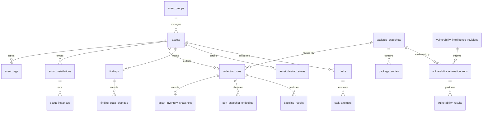

# Sentinel 数据库设计

本文记录一期数据库设计。三份 SQL 草案保留供评审，一期 A 已提供四份 SQLx 应用迁移，共 47 张业务表；当前实现范围见 [实现接口约定](implementation-contract.md)。产品范围见 [需求与分期](requirements.md)，通信、部署与升级见 [架构规划](architecture.md)。

## 1. 已确认条件与本稿建议

| 类别 | 约定 |
| --- | --- |
| 已确认 | Hub、Scout 使用 Rust；PostgreSQL 保存业务数据，NATS JetStream 传递消息，Elasticsearch 保存系统日志 |
| 已确认 | 单组织，1,000 台以上 Ubuntu 主机；每台资产一个管理分组、多个标签 |
| 已确认 | 指标分钟级保留 7 天，小时级保留 90 天；采样频率仍可调整 |
| 已确认 | 一期资产、运行状态、软件包漏洞与认证配置基线；恶意文件扫描第二期 |
| 已确认 | 每张表统一 `id` 单列主键、`create_time`、`update_time`、`delete` 四字段 |
| 本稿建议 | PostgreSQL 17+，普通表与时间索引，不依赖扩展；版本和部署规格在实施时锁定 |
| 本稿建议 | 分组暂不分层；策略按默认、组、资产整份覆盖；角色动作矩阵、登录方式后续细化 |
| 本稿建议 | 快照、执行历史与当前状态分开；指标分段聚合；业务写入与消息通过 outbox/inbox 衔接 |

SQL 只定义数据结构，不安装数据库、连接实际服务、创建业务账号或引入 Rust 依赖。未包含 SaaS 租户、通知渠道配置、模型会话、恶意文件结果表；这些随对应功能增加。

## 2. 存储职责

| 位置 | 保存内容 | 查询或恢复用途 |
| --- | --- | --- |
| PostgreSQL | 资产身份、分组标签、策略、发布版本、任务、检测结果、风险状态、指标聚合、管理审计 | Hub 页面、授权、调度、追溯 |
| Elasticsearch | 经授权采集并脱敏的系统日志及检索字段 | 跨主机 IP、账号、事件调查与统计 |
| NATS JetStream | 有期限、有容量上限的传输缓冲 | 断线重投、消费者恢复；不作为业务状态的唯一记录 |
| Scout 宿主持久目录 | 安装身份、私钥、本地待传数据、任务去重、活动锁、升级恢复记录 | 重启与断网恢复、容器交接 |

PostgreSQL 不复制保存全部原始日志。管理审计与主机系统日志分开：前者记录谁修改策略、下达任务或导出数据，后者用于安全调查。大型附件将来按独立存储引用接入，不塞入通用 JSON 字段。

PostgreSQL 提交与 Elasticsearch 写入没有跨库事务。后续日志消费者逐项处理批量写入结果，失败项可重试，完成持久化后确认消息。事件去重需同时考虑索引路由和生命周期，不能仅凭跨索引重复使用文档 ID 宣称全局唯一。

## 3. 关系概览



图中省略凭证、授权、消息和指标表，字段与外键以 SQL 为准。核心关系不使用通用的 `(object_type, object_id)` 代替外键；审计目标只作为历史描述，允许这种表示。

## 4. 字段与约束约定

统一规范以 [AGENTS.md](../AGENTS.md) 为准。三份设计草案共有 46 张业务表；一期 A 的正式迁移另增加 `process_snapshot_entries`，共 47 张。关联、历史、证据和指标表均以前置四字段定义：

```sql
id uuid PRIMARY KEY,
create_time timestamptz NOT NULL DEFAULT now(),
update_time timestamptz NOT NULL DEFAULT now(),
"delete" boolean NOT NULL DEFAULT false
```

| 字段 | 语义与维护 |
| --- | --- |
| `id` | 应用生成 UUID，单列主键；创建后不可修改 |
| `create_time` | 记录创建时刻，默认数据库事务时间；创建后不可修改 |
| `update_time` | 插入时有默认值，后续更新由统一行触发器维护；软删除同样刷新 |
| `delete` | 布尔软删除标记，默认 `false`；SQL 中统一引用为 `"delete"` |

`sentinel.set_row_metadata()` 在每张表的 `BEFORE UPDATE` 触发器执行：拒绝更改 ID 或创建时间，更新时间取数据库实际时钟、原更新时间加一微秒、创建时间三者最大值。这样即使同一事务内多次更新或时钟略有回拨，更新时间仍推进；它不是业务消息序号。[PostgreSQL 触发器](https://www.postgresql.org/docs/current/trigger-definition.html)、[时间函数](https://www.postgresql.org/docs/current/functions-datetime.html)

原复合主键改为业务 `UNIQUE`，一对一表中的资产/任务键也保留 `NOT NULL UNIQUE`。业务重投命中原唯一键后更新允许变动的字段，保留已有 `id` 与 `create_time`，不能在 upsert 中用新生成 ID 替换旧 ID。

普通查询、列表、统计与调度都过滤 `NOT "delete"`，关联查询同时检查各对象的软删除和业务状态。例如读取可用资产时同时检查资产与管理组：

```sql
SELECT a.id, a.display_name
FROM sentinel.assets AS a
JOIN sentinel.asset_groups AS g ON g.id = a.group_id
WHERE NOT a."delete" AND NOT g."delete" AND a.lifecycle = 'active';
```

外键只证明记录存在，不证明其未软删。鉴权还需检查用户、角色绑定、安装身份、凭证和资产状态；审计/历史恢复使用独立的授权查询，不能把软删除历史当成未曾发生。软删除被当前 head 或证据链引用的记录前，要在事务中处理依赖，不能靠默认过滤把风险或采集结果变成“没有发现”。

唯一键分两种：管理组名称、标签、角色和策略绑定仅对未删除记录唯一，允许以新 ID 重新建立；快照、修订、评估结果、目标代次、任务幂等、inbox 与指标桶等永久业务键跨软删除保留。需要恢复时处理原记录，不能重新生成重复事实。非终态采集、任务、尝试、漏洞评估和未发出的 outbox 禁止软删除；身份/凭证先吊销、实例先退出、资产先退役。软删除不等于取消、风险修复或释放升级名额。

- 资产 ID 不由主机名、IP、MAC 或机器指纹直接生成。
- 时刻使用 `timestamptz`，聚合和保留窗口采用 UTC。保留 Scout 观测时间与 Hub 接收时间，时钟回拨或偏差记录质量问题。通用时间列与这些业务时间分开。
- 地址使用 `inet`，端口使用有范围约束的整数；接口作用域与网络命名空间单独表达。
- 软件包版本保存完整字符串，由匹配器按 Debian 版本规则解释；禁止 SQL 字符串大小比较。
- 容量使用字节，速率使用字节/秒，CPU 使用归一化的 0–100 百分比。计数差使用足够宽的 `numeric`，所有输入拒绝非有限数值。
- 核心标识、状态、时间、版本、关联键和常用过滤字段均有独立列。`jsonb` 仅用于有版本、有大小上限的配置、覆盖说明和脱敏证据；数组条数、深度与敏感字段由应用校验。
- 内部摘要使用 32 字节 `bytea`；情报与规则内容摘要在 003 中使用受格式约束的十六进制文本。对摘要比较时先统一编码，不能直接比较两种表示。
- `NULL` 表示未知或未获得，零表示已测得零。无采集结果、失败、部分覆盖与通过是不同状态。
- 不使用删除资产时的历史级联删除。通常停用/退役，再按保留策略处理引用链。

跨资产关系使用复合外键，例如 `(result_id, asset_id)`，防止把甲主机的结果挂到乙主机。普通 `CHECK` 不负责跨行完整性和状态机；可空字段的 `CHECK` 也不能替代 `NOT NULL`。[PostgreSQL 约束说明](https://www.postgresql.org/docs/current/ddl-constraints.html)

## 5. 资产、身份与采集

对应 [001_inventory.sql](sql/001_inventory.sql)。

| 表 | 核心字段/唯一关系 | 用途 |
| --- | --- | --- |
| `asset_groups` | `id`、未删除记录名称唯一 | 扁平管理组 |
| `assets` | `id`、必填 `group_id`、生命周期 | 稳定资产记录，退役保留历史 |
| `asset_tags` | `id` 主键；未删除记录 `(asset_id, key)` 唯一 | 一台主机多个标签，同一键一个值 |
| `scout_installations` | 资产、安装 `generation`、状态 | 重装/重新登记代次；每资产最多一个 active 身份 |
| `scout_credentials` | 凭证摘要、公钥摘要、有效期、吊销时间 | 续期可复用公钥；服务端不保存 Scout 私钥 |
| `scout_instances` | 安装身份、实例、角色、活动 `epoch` | 新旧容器并存，Hub 每资产只接纳一个 active 实例 |
| `asset_fingerprint_observations` | 算法修订、派生摘要、来源实例 | 指纹变化历史与重复登记线索；摘要不唯一 |
| `identity_conflicts` | 涉及资产、原因、证据、处理状态 | 克隆/重复身份调查，不自动合并资产 |
| `collection_runs` | 资产、身份、类型、范围、持久序号、状态 | 每次采集尝试、预期范围、覆盖和实际规则清单 |
| `asset_collection_heads` | `id` 主键；`(asset_id, kind, scope_key)` 唯一 | 最近尝试与最近完整结果的两个独立指针 |
| `asset_inventory_snapshots` | 一次 inventory run 一个结果 | 主机、系统、内核、CPU、内存和有界设备清单 |
| `process_snapshot_entries` | run、PID、启动 tick 唯一 | 一期 A 正式迁移新增的有界进程摘要；不含命令行、环境变量 |
| `package_snapshots` | `(asset_id, content_sha256)` 唯一 | 不可变完整软件包清单内容 |
| `package_entries` | `id` 主键；`(snapshot_id, package_name, architecture)` 唯一 | 二进制/源包完整版本、来源及证据 |
| `port_snapshot_endpoints` | run、命名空间、协议、地址、作用域、端口 | TCP 监听和 UDP 绑定的去重端点 |
| `docker_port_mappings` | run、容器、协议、宿主地址与映射端口 | Docker 发布映射，独立于监听端点计数 |

### 身份与顺序

资产 ID 关联长期历史；安装身份用于认证；实例 ID 标识一次程序运行；活动 epoch 标识一次独占采集阶段。凭证轮换不生成新资产。重装是否重新绑定旧资产必须通过授权登记，指纹不能恢复权限。

Hub 从已认证安装身份确定资产，不信任 payload 自称的资产 ID。新安装 generation、活动 epoch 和消息序号用于准入与排序，接收时间只用于延迟及在线状态。候选实例不能抢占当前结果；旧实例可补传合法历史，不能覆盖当前状态。克隆凭证可能伪造递增序号，数据库唯一键不能解决这类身份冲突，需要登记、会话和冲突处置一起约束。

`collection_runs.sequence` 在安装身份内持久递增，与高频指标的序列独立。`scope_key` 区分整机与专项，例如整机端口清单和某个网络命名空间检查不能互相覆盖。

### 完整快照发布

1. 为采集分配稳定 run ID 和序号，记录预期范围、规则修订与上下文。
2. 分块上报时在有容量与期限限制的暂存区组装。核对来源、摘要、条数和覆盖，再发布结果。
3. 同一事务写入最终结果、完成状态、inbox 回执并更新 head；事务提交后确认消息。
4. `latest_attempt_id` 与 `latest_complete_id` 分别排序推进。例如序号 12 失败先到、序号 11 完整结果后到，最近尝试仍为 12，完整结果仍可推进到 11。
5. 查询同时展示最近完整结果、最近失败原因及数据年龄；过期结果保留并标识 stale，不伪装成当前检查通过。

完整与安全是两个维度：清单完整不代表所有第三方软件包可评估，规则执行结束也可能包含 unknown。仅完成规定范围的整体采集才可推进对应完整指针，错误与未覆盖项目不能被缺行掩盖。

软件包内容不变时复用快照，但新增采集 run 更新“再次观察到此清单”的时间。否则每次扫描都重新插入数百万条包记录。快照摘要包含发行版、架构、源包版本、来源信息及 schema，不能只对包名排序后计算。

SSH 基线保存规则与上下文结果，磁盘配置和运行状态分别说明；不保存密码、密码散列或完整认证配置。诊断使用 `collection_runs(kind='diagnostic')` 的有版本、有界摘要保存结果，未来大型结构化证据再增加专表。

## 6. 软件包漏洞、基线与风险

对应 [003_assessments.sql](sql/003_assessments.sql)。

| 表 | 作用 |
| --- | --- |
| `vulnerability_intelligence_revisions` | 情报内容修订、同步状态、源版本和检查时间；ready 后正文不可变 |
| `ubuntu_package_advisories` | CVE、Ubuntu 版本、源包、适用架构、官方状态与修复版本 |
| `vulnerability_evaluation_runs` | 固定一次评估使用的清单、情报修订和匹配器版本 |
| `vulnerability_package_coverage` | 每个包的已评估、未知来源、未支持或错误状态 |
| `vulnerability_results` | 匹配候选的明确结论、严重性、修复版本与依据 |
| `asset_vulnerability_heads` | 最近尝试与最近可用完整评估指针 |
| `baseline_rule_revisions` | 不可变规则定义、适用范围、严重性与修复说明 |
| `baseline_results` | run、规则、上下文唯一；区分 pass/fail/unknown/error/not_applicable/not_run |
| `findings` | 当前风险状态与人工处置状态，明确引用领域结果 |
| `finding_state_changes` | 每次风险状态/人工处置变化的追加历史 |

采集和漏洞评估是两件事。同一清单可随情报或匹配器更新而重新评估，保留原结论用于追溯。匹配使用 Ubuntu 发行版、二进制/源包及完整版本，架构适用集合由导入器校验互不重叠；不能把仅有上游版本或来源未知的软件包判为安全。

不建立“每个包 × 全部 CVE”的正常结果矩阵。每包有覆盖记录，候选漏洞有结论；“无命中”只有在覆盖成功、情报适用且输入完整时才有含义。

风险稳定键建议为：

- 软件包：发行版范围 + CVE + 二进制包名 + 架构。
- 基线：稳定规则 key + 规范化检查上下文摘要。

稳定键不包含采集时间、安装版本和规则修订，以便修复、复发仍追踪同一问题。`technical_state` 表达 present/resolved/unknown；`disposition` 表达 open/acknowledged/accepted_risk/false_positive。接受风险不会把技术事实改成已修复。

更新风险投影时，锁定当前评估指针，核对当前有效清单、目标情报和匹配器版本，再校验风险键与结果身份，使用 `version` 防并发覆盖，同事务追加变化历史。CAS 只能防并发丢更新，不能替代新旧结果判定。旧任务晚完成只追加历史，不能恢复已被新结论替代的风险状态。

关闭风险必须有对应问题的适用、成功且足够新鲜的依据。failed、partial、unknown、未运行或取消规则不会自动关闭旧问题。包卸载可使用完整新清单对应的 `closure_evaluation_id` 证明移除，不能因为一次评估缺少某个结果就关单。同主机另一条 CVE 或另一条 SSH 规则的通过结果也不能作为关闭依据。

`latest_complete_id` 和关闭依据的外键只保证引用存在且属于同一资产，不证明完成度、时效或问题身份；这些是后续应用事务的必测条件。情报重新分析不意味着主机清单被重新采集，界面仍显示清单观测时间。

## 7. 用户、策略、任务与升级

对应 [002_control.sql](sql/002_control.sql)。

| 表 | 作用 |
| --- | --- |
| `users`、`role_bindings` | 用户状态和全局/管理组角色；登录映射待确定 |
| `policies`、`policy_revisions`、`policy_bindings` | 策略名称、不可变发布修订、默认/组/资产绑定 |
| `scout_releases` | 镜像 digest、签名元数据、平台、部署规格、协议与本地数据兼容要求 |
| `asset_desired_states` | `(asset_id, generation)` 的追加式目标历史，固定策略和目标发布版本 |
| `asset_control_states` | 当前期望代次、已完整应用代次、实际策略和程序版本、收敛状态 |
| `tasks` | 每主机一个有类型的任务、幂等请求、期限、当前执行尝试 |
| `task_attempts`、`task_events` | 业务重试与执行事件；网络重投复用原 attempt |
| `upgrade_rollouts`、`upgrade_targets` | 灰度批次、固定目标集合、并发与观察参数 |
| `upgrade_attempt_details` | 旧/候选实例、交接、观察、提交、回退和恢复阶段 |
| `outbox_messages`、`inbox_receipts` | 事务内待发消息与消费去重 |
| `audit_events` | 策略、授权、任务、升级和查询导出的管理审计 |

### 分组、授权与策略

建议内置 admin、operator、viewer、release_manager，具体动作矩阵在接口设计时固定。标签不授予权限。查询、统计、导出、证据读取和批量操作都按当前管理组授权，不能只过滤列表页面。

策略优先级为默认 < 管理组 < 资产，选中一份完整配置后校验，不进行不透明的 JSON 深层合并。绑定和目标分别存储：绑定表示配置意图，资产目标固定当时解析出的内容与摘要。配置变更、版本降级和回滚授权都创建新的 generation，不修改历史目标。

资产换组需要转出与转入权限；事务内审查并显式保留或清除资产级覆盖，重新生成目标及审计。否则旧组的资产例外会继续覆盖新组策略。尚未派发的任务在派发时再次检查有效授权和范围；已执行任务如何取消由任务类型决定，不能用删除记录代替远端取消。

后续 Elasticsearch 授权也以当前可访问资产集合为准。日志中的历史组名仅是事件上下文，不能让旧组用户永久读取已转出的资产。查询和聚合使用相同资产过滤规则。

### 任务与升级状态

一期任务类型限定为资产、包、端口、基线、结构化诊断和升级；参数按类型验证，没有任意命令任务。

稳定 task ID 表示用户意图，attempt ID 表示一次执行尝试。消息重投不新建 attempt，真正业务重试才增加尝试编号。状态报告携带执行身份和序号；旧 attempt 的迟到事件只能更新对应历史。

`unknown` 表示执行结果不确定，不能作为安全重试依据。每台资产最多有一个未终结升级，unknown 也占用名额。超时、断线或请求取消，不证明远端已经停止。批次并发由调度事务控制，部分唯一索引只负责单主机互斥。[部分索引说明](https://www.postgresql.org/docs/current/indexes-partial.html)

升级 target 只记录待调度、已调度、跳过或取消；执行结果读取 task，避免两套完成状态。普通当前状态由活动实例上报；旧实例仍可作为升级协调者提交 observing/committed/rolled_back，按绑定的 attempt、协调者身份和单调阶段序号接纳，不能简单要求所有升级事件都来自新的 active 实例。

数据库记录过程，不替代宿主本地活动锁、持久队列和恢复状态。旧实例仍可运行时才具备内置回退条件；提交后若无可运行实例，需要外部恢复，数据库不能自行完成镜像回滚。

### 消息事务边界

Hub 下发：业务变更、审计和 outbox 同事务提交；发送器通过短事务领取带 token 的租约，事务外发布到 JetStream，获得确认后以 token 条件更新 published。崩溃后重发复用原消息 ID。领取并发队列可使用 `FOR UPDATE SKIP LOCKED`，不持有行锁等待网络。[PostgreSQL 查询锁说明](https://www.postgresql.org/docs/current/sql-select.html)

Hub 接收：认证安装身份后，用 `(handler_key, producer_installation_id, event_id)` 去重，摘要不同则报冲突；inbox、业务结果和投影在同一事务提交，提交后 ACK。`handler_key` 不随二进制版本改变。published、收到消息和执行成功是三个不同阶段。

inbox 的保留期必须覆盖允许的 Scout 补传与队列重放窗口。清理回执后仍依赖领域唯一键、版本和活动代次抵御过期重放；超出允许窗口的消息走明确的过期/恢复流程，不盲目写入当前状态。

## 8. 指标与容量

| 表 | 数据 |
| --- | --- |
| `asset_metric_latest` | 每资产一行，最近 CPU、内存、进程数、负载、Swap、设备摘要、Scout 自身健康与质量状态 |
| `host_metric_buckets` | CPU 加权和/有效时长/峰值，内存加权和/峰值，进程数量、负载和 Swap 摘要 |
| `network_metric_buckets` | 每个接口实例的字节增量、有效时长、峰值速率、错误和丢包增量 |
| `filesystem_metric_buckets` | 每个文件系统实例的容量、可用量、使用峰值及 inode 摘要 |

这三类历史表均使用普通表，每表 `id` 为单列主键，同一表通过 `resolution_seconds=60/3600` 区分分钟和小时记录。原资产、时间桶、资源及活动代次组成的业务键保留为全局唯一约束，同一 ID 即使换到另一时间桶也不能重复。

此调整是统一主键规范的直接结果：PostgreSQL 的时间分区表要求主键包含分区键，无法直接提供严格的 `PRIMARY KEY (id)`。因此移除时间分区和六张中间分区表，改用时间索引与分批清理；不以包含额外列的主键冒充单列主键。未来若压测需要分区，先评审与统一规范兼容的方案。[PostgreSQL 分区限制](https://www.postgresql.org/docs/current/ddl-partitioning.html)

### 采样与聚合协议

采样频率不等于存储粒度。可先压测 15 秒采样这一建议值，由 Scout 上报分钟聚合及当前值，数据库不逐个存储所有原始采样。按资源和期望实时性再调节，不能把 15 秒描述为已确认要求。

历史桶保留 `(installation_id, active_epoch)` 分段。重启、升级接管、回退恢复或重新登记都建立新的活动段，来源实例由外键绑定资产。同一分辨率、时间桶和资源的段内累计数据使用持久递增的 revision，Hub 收到更高 revision 后替换该桶的该段；不同桶或分段的 revision 不相互比较，重复消息不能叠加计数。

同一分钟发生交接时，旧段和新段各保留自己的有效区间，按资产和桶合并查询。Hub 验证活动所有权、区间合法且不重叠；同资产、分辨率和时间桶的相关写入事务串行化。主机 CPU 与内存分别计算覆盖；网络和文件系统按同一资源计算覆盖，每项跨段有效时长总和不能超过桶长，不能把多张网卡、多个文件系统或不同指标的秒数相加后与桶长比较。单行 CHECK 只校验本段区间，不能证明多行之间不重叠。补传旧段只修正历史段，不能覆盖新的当前值。

`observed_from/until` 表示本段覆盖的最早与最晚边界，期间可能有缺测；`observed_seconds` 保存真正有效时长。计数差按实际有效时间计算，桶边界处切分采样区间并标明估算；重启/计数器重置时丢弃不可用的差值，首个样本速率为 unknown。

小时聚合由 Hub 从分钟段重算，保留相同段键，在聚合事务内生成小时 revision。对加权和、计数差和有效时长分别求和；峰值取最大；last 取最新有效值。迟到或修正分钟触发相关小时重算，不直接累加旧小时，也不复用分钟 revision 作为小时水位。

例如 CPU 平均值为 `sum(cpu_percent_seconds_sum) / nullif(sum(cpu_observed_seconds), 0)`，网络平均速率为有效字节差/有效秒数。不能平均各分钟平均值；缺测也不能补零。网卡 key 包含启动/接口实例信息，避免 eth0 被替换后拼成一个计数器；展示总吞吐时按网卡类型防止网桥与物理卡重复计数。

### 时间索引与保留

每张指标历史表建立 `(resolution_seconds, bucket_start, id)` 索引，用于全局时间范围扫描和限量清理；原业务唯一索引支持按资产、分辨率与时间范围查询。查询还过滤 `NOT "delete"`，分辨率与业务唯一性不因软删除改变。

分钟 7 天、小时 90 天仍按精确滚动窗口执行。普通业务隐藏/删除使用软删除，但仅置标记不会释放磁盘空间；到期物理清理使用独立维护权限，在小事务中按时间索引选取限量 ID 后删除，限制每批行数、总耗时与写入速率。记录清理水位、失败重试和积压，不进行整表大事务清理。

分钟清理前检查对应完整小时的聚合已成功且超过允许修正水位；聚合失败时暂缓删除并告警，防止丢失唯一来源。为避免只删除半个小时后又用剩余分钟覆盖已有小时，清理水位按完整小时推进，查询仍按精确 7 天过滤。迟到补传上限和修正窗口在实施时配置；超过可重算窗口的消息记录覆盖缺口，不重新写入已清理的旧桶。

统一元数据和独立主键增加了行宽与索引开销。普通表持续清理还会产生 WAL 和死元组，压测与运维必须覆盖 autovacuum、索引膨胀、清理落后和备份负载；不能沿用删除整个分区的成本假设。物理清理可以直接删除符合条件的到期行，无需先逐行软删除再删除一次。

1,000 台稳定在线、每主机每桶一段时，主机指标约为：

- 分钟：`1,000 × 1,440 × 7 = 10,080,000` 行。
- 小时：`1,000 × 24 × 90 = 2,160,000` 行。

网卡与文件系统行数还要分别乘以每台纳入采集的资源数，交接产生额外段。不能用这两个数字直接承诺磁盘容量；压测需要包含行宽、索引、WAL、备份、并发写入与实际设备数。限制短生命周期虚拟设备数量与高频枚举，防止无界增长。

## 9. 查询、索引与其他保留策略

| Hub 用途 | 查询入口/主要索引 |
| --- | --- |
| 主机列表和分组过滤 | `assets(group_id,lifecycle,id)`，再连当前指标及采集 head |
| 标签筛选 | `asset_tags(key,value,asset_id)`；多个标签用存在条件，避免连接放大计数 |
| 当前包/端口 | head 指向完整 run，再查快照主键；端口使用 `inet` 网段过滤回环 |
| 主机风险列表 | `findings(asset_id,technical_state,severity)`，当前问题使用部分索引 |
| 按 CVE 查影响主机 | 结果 CVE 索引与当前风险/head 共同限定，不能直接把历史结果算成当前影响 |
| 主机任务时间线 | `tasks(asset_id,create_time,id)`、`task_events(task_id,received_at,id)` |
| 待发消息/过期租约 | outbox pending/leased 部分索引 |
| 指标图表 | 按资产/分辨率/时间使用业务索引；时间清理使用独立索引，跨段正确聚合 |
| 安全日志调查 | Elasticsearch 按时间和当前授权资产过滤，再按来源 IP/账号/事件聚合 |

列表使用稳定排序和游标分页；统计通过明确过滤查询，所有可用对象查询包含软删除条件。初期不单独索引低区分度的 `delete` 列，不为所有 JSON 字段建立通用索引，也不建立大量重复计数缓存，待查询计划和负载证明需要后再增加。

除指标外，保留天数暂不定死。实施前需要给以下数据配置容量与时间上限：

| 数据 | 清理规则 |
| --- | --- |
| 当前身份、目标、head 与风险 | 仍被引用时必须保留；资产退役不直接删除 |
| 快照和领域结果 | 删除历史前检查 head、评估、finding 和历史证据依赖；完整证据链不能被静默截断 |
| 软件包内容 | 内容去重；只有无采集、评估及证据引用的快照才可清理 |
| 情报/规则修订 | 不删除仍被结果引用的修订；不得原地重写旧依据 |
| 任务和升级轨迹 | 未终结及恢复中的任务保留，完成历史按审计与运维需求配置 |
| inbox/outbox | 待处理消息不按时间盲删；已处理数据与允许重放窗口协调 |
| 审计和系统日志 | 分别确定保留与访问权限，不继承指标的 7/90 天设置 |

软删除与到期物理清理是不同操作，均需考虑历史依赖。物理清理使用独立维护权限，按依赖顺序执行。部署需要迁移、运行、备份/恢复、保留清理的权限边界；统一元数据触发器只维护元数据，不解除已发布正文不可变或审计追加权限。审计追加写不等于对数据库管理员不可篡改。PostgreSQL 的备份和时间点恢复策略需要实际演练，不能用 JetStream 保留替代。

## 10. 实施顺序与验证边界

| 阶段 | 对应内容 |
| --- | --- |
| 一期 A | 001 的资产、身份、采集、指标；002 中最小授权、目标、可靠上报和升级基础 |
| 一期 B | 003 的情报、软件包评估、基线和风险；完善策略定时任务 |
| 一期 C | 任务诊断、风险处置历史、变化呈现和规模验证 |
| 后续 | 系统日志检索契约、恶意文件领域表、实际 AI 分析记录，随需求独立增加 |

三个编号文件是按依赖拆分的完整评审 DDL，不等于三个产品阶段。一期 A 已将其转换为 `migrations/0001_inventory.sql` 至 `0003_assessments.sql`，由 SQLx 管理事务和执行记录，`0004_process_inventory.sql` 增加进程摘要表。前三份迁移去掉草案外层 `BEGIN/COMMIT`，并在 `SET LOCAL search_path` 中保留 `public`，供 SQLx 在同一事务写入账本；原稿不变。应用在固定连接上以 `public` 路径创建和读取 `_sqlx_migrations`，完成后恢复业务查询路径，避免首次启动与重启使用不同账本。原设计草案仍保留供评审；正式迁移投入使用后的演进须新增迁移，并固定客户端、回填和兼容发布流程。

执行顺序为 [001_inventory.sql](sql/001_inventory.sql) → [002_control.sql](sql/002_control.sql) → [003_assessments.sql](sql/003_assessments.sql)。只能对全新测试库执行一次，脚本未使用 `IF NOT EXISTS` 掩盖结构差异。应用安装和升级应使用 `hub migrate` 或 Hub 启动时的 SQLx 迁移，不能将草案再次导入已初始化的库。尚未进行生产迁移；旧草案若已部署，需另写改名、回填 ID、重建约束和指标结构转换的版本化迁移。随后可运行 [verify.sql](sql/verify.sql)，测试在事务内建立虚构资产与临时断言表，结束时回滚，可重复运行。

设计阶段在临时 [PGlite](https://pglite.dev/docs/) 的 PostgreSQL 18.6 引擎上执行三份 DDL，通过 94 个命名断言（22 个正例、72 个反例）。一期 A 又使用本机临时 PostgreSQL 17.11 原生实例执行三份草案并连续验证两次，全部通过、回滚后无测试资产残留。验证覆盖全部业务表四字段/单列主键/默认值/触发器，以及自动更新时间、元数据不可改写、软删后重建绑定、永久去重、在途禁删、跨时间桶 ID 唯一及业务键去重；正式四份迁移后的 47 表也已通过全部 94 断言，包含新增进程摘要表。Hub 应用测试另验证重启迁移幂等、登记、授权、签名绑定、事件去重与乱序、软删除及吊销。

上述结果不代表真实并发、千台容量或全部应用状态机已经验证。后续集成测试必须覆盖：乱序结果不得回退 head 或误关风险；同资产不同问题不能混用证据；分段时长与所有权校验；小时重算和保留；换组授权与策略变更；outbox 租约丢失；任务执行结果未知；新旧实例交接与恢复。
